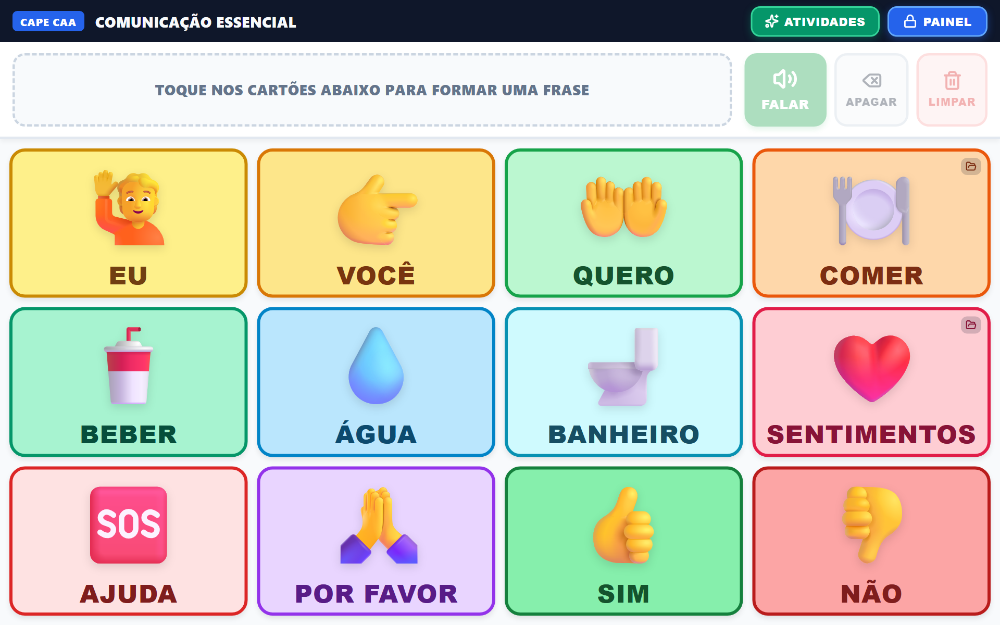
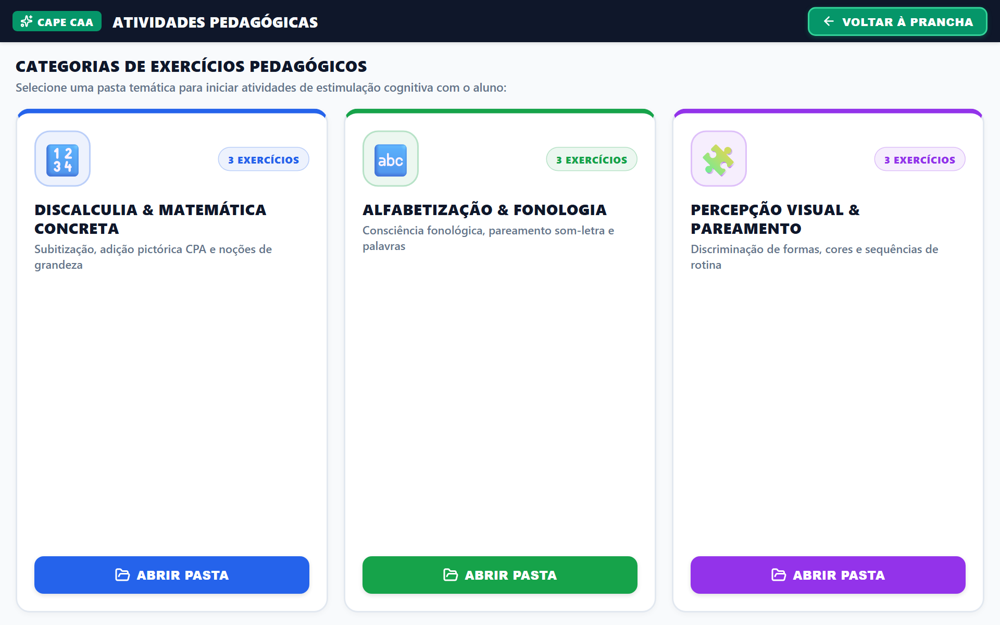
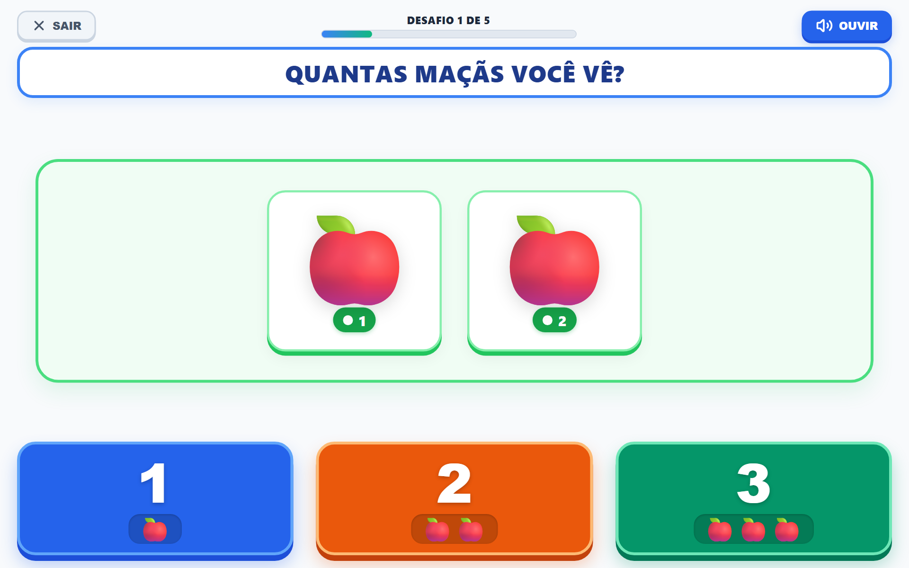
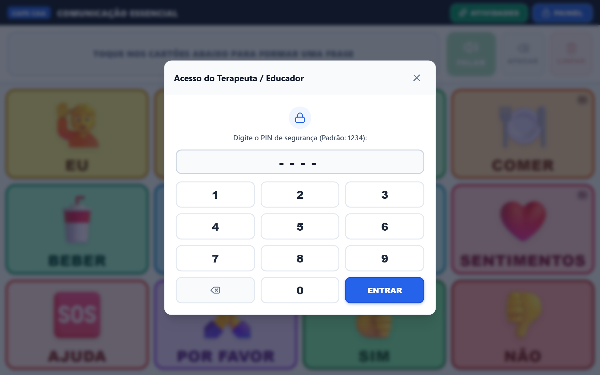
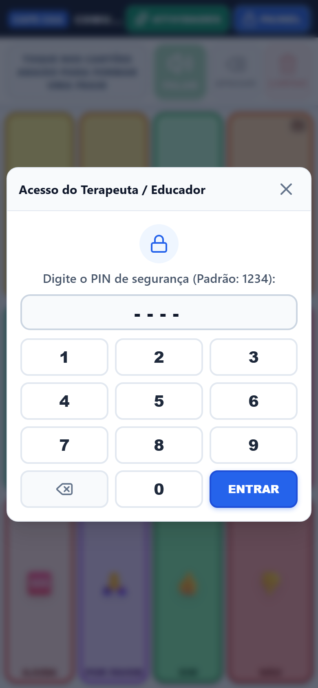

# 🗣️ CAPE CAA — Plataforma de Comunicação Alternativa e Ampliada

<div align="center">


**Desenvolvido para o Centro de Apoio Pedagógico Especializado (CAPE) de Vitória da Conquista - BA.**  
*Substituindo pastas físicas PECS pesadas por uma prótese de voz digital em tablets de baixo custo e smartphones.*

[Demonstração](#-galeria-visual-da-aplicação) • [Funcionalidades](#-principais-funcionalidades) • [Chave de Fitzgerald](#-chave-de-fitzgerald-modificada) • [Arquitetura](#-arquitetura-e-tecnologias) • [Instalação](#-como-executar-o-projeto)

</div>

---

## 🎯 Visão Geral

O **CAPE CAA** é uma aplicação PWA (*Progressive Web App*) de Comunicação Alternativa e Ampliada projetada com rigor ergonômico e cognitivo para estudantes com **Transtorno do Espectro Autista (TEA)**, **paralisia cerebral**, **síndrome de Down** e **atrasos severos de fala**.

A plataforma atua como uma prótese de comunicação humana ininterrupta, garantindo independência verbal, estruturação sintática de frases e estimulação pedagógica concreta sem depender de conexão com a internet.

---

## 📸 Galeria Visual da Aplicação

### 1. Prancha Principal de Comunicação (PECS)
Barra superior de sentença com feedback luminoso, filtro motor anti-tremor e grade dinâmica ortogonal categorizada pela Chave de Fitzgerald.


---

### 2. Central de Atividades Pedagógicas
Pastas temáticas de estimulação cognitiva com navegação intuitiva desacoplada da prancha de comunicação.


---

### 3. Módulo Gamificado de Discalculia (Bruner CPA)
Exercícios matemáticos concretos (Contagem 1-a-1, Adição Visual e Comparação) com reforço positivo sonoro e alvos táteis 3D.


---

### 4. Painel de Ajustes e Sistema do Educador (PIN 1234)
Área restrita para fonoaudiólogos e educadores: catálogo de vozes neurais brasileiras, densidade de grade e diagnóstico offline.


---

### 5. Ergonomia Móvel Responsiva (100dvh)
Layout otimizado para celulares e tablets em orientação retrato, sem barras de rolagem mortas e com zonas táteis ampliadas.
<div align="center">
  
</div>

---

## ⚡ Principais Funcionalidades

| Recurso | Descrição Pedagógica & Técnica |
| :--- | :--- |
| **📶 100% Offline-First** | Funciona sem internet. Vocabulário, pranchas e fonemas sintetizados são armazenados no IndexedDB com política anti-evicção do navegador. |
| **🗣️ Síntese de Voz Contínua** | Reprodução de frases completas sem intervalos robóticos entre palavras, com entonação conclusiva natural e pré-aquecimento de cache em segundo plano. |
| **🎙️ Vozes Neurais de Estúdio** | Motor Edge-TTS com vozes humanizadas (Francisca, Antônio, Thalita) e fallback transparente para sintetizador nativo do sistema operacional. |
| **🧠 Acessibilidade Cognitiva (COGA)** | Barra de sentença superior fixa para descarregar a memória de trabalho da criança. |
| **🛡️ Filtro Anti-Espasmo Motor** | Throttling de 300ms nos eventos de toque para mitigar espasmos musculares involuntários e toques duplicados acidentais. |
| **📚 Currículo Didático Integrado** | Módulos de Discalculia Concreta, Alfabetização & Fonologia (Letra Inicial, Sílabas) e Percepção Visual (Cores, Formas, Rotina PECS). |
| **🔒 Modo Terapeuta Protegido** | Configurações, densidade da grade (2x2, 3x3, 4x3) e adição de novos cartões protegidos por PIN de segurança (`1234`). |

---

## 🎨 Chave de Fitzgerald Modificada

A organização visual obedece estritamente ao código cromático morfossintático da CAA com conformidade **WCAG AAA** de contraste:

| Categoria Gramatical | Cor de Fundo | Cor de Borda | Aplicação Prática |
| :--- | :---: | :---: | :--- |
| **Pessoas & Pronomes** | `#FEF08A` | `#CA8A04` | Eu, Você, Mamãe, Papai, Professora, Terapeuta |
| **Ações & Verbos** | `#BBF7D0` | `#16A34A` | Quero, Comer, Beber, Ir, Brincar, Parar, Ajudar |
| **Substantivos & Objetos** | `#FED7AA` | `#EA580C` | Água, Maçã, Banheiro, Bola, Mochila, Livro |
| **Descritivos & Emoções** | `#BAE6FD` | `#0284C7` | Feliz, Triste, Bravo, Cansado, Grande, Pequeno |
| **Social & Cortesia** | `#FBCFE8` | `#DB2777` | Olá, Tchau, Por Favor, Obrigado, Sim, Não |
| **Conectivos & Diversos** | `#F1F5F9` | `#64748B` | E, Para, Com, Na, No, Mais |

---

## 🏗️ Arquitetura e Tecnologias

```
src/
├── components/          # Componentes desacoplados com responsabilidade única
│   ├── activities/      # Players gamificados, fichas concretas e celebração
│   ├── admin/           # Painel restrito, seletor de emojis e status de memória
│   ├── board/           # Grade ortogonal de comunicação e cartões táteis
│   ├── common/          # Header adaptativo, modais e renderizador de ícones
│   └── sentence-bar/    # Barra de sentença superior e controles de fala
├── constants/           # Currículos didáticos, sementes e Chave de Fitzgerald
├── db/                  # Persistência Dexie.js (IndexedDB) e repositórios CRUD
├── server/              # Plugin Vite para proxy WebSocket do Edge-TTS
├── services/            # Orquestrador de fala, cache de áudio e efeitos sonoros
├── stores/              # Estados reativos Svelte (sessão, pranchas, sentença)
└── types/               # Modelos e tipagens TypeScript rigorosas
```

- **Frontend:** [Svelte 5](https://svelte.dev/) com Runes (`$state`, `$derived`, `$props`).
- **Linguagem:** [TypeScript](https://www.typescriptlang.org/) em modo strict.
- **Armazenamento Local:** [Dexie.js](https://dexie.org/) sobre a Web API IndexedDB.
- **Áudio Sintético:** Web Audio API nativa para arpejos e confirmações táteis de baixa latência.
- **Voz Neural:** Microsoft Edge Read Aloud DRM 2.1 via WebSocket com streaming MP3.
- **PWA Tooling:** `vite-plugin-pwa` com Workbox e Service Worker de precache offline.

---

## 🚀 Como Executar o Projeto

### Pré-requisitos
- [Node.js](https://nodejs.org/) versão 18 ou superior.
- [pnpm](https://pnpm.io/) (recomendado) ou `npm`.

### Passo a Passo

1. **Clone o repositório:**
   ```bash
   git clone https://github.com/PedroT4skr/cape-.git
   cd cape-
   ```

2. **Instale as dependências:**
   ```bash
   pnpm install
   # ou: npm install
   ```

3. **Inicie o servidor de desenvolvimento:**
   ```bash
   pnpm dev
   # ou: npm run dev
   ```
   Acesse a aplicação em `http://localhost:5173/`.

4. **Gerar build de produção otimizado para o PWA:**
   ```bash
   pnpm build
   # ou: npm run build
   ```

---

## 🔐 Credenciais Padrão do Painel Educador

- **PIN de Segurança:** `1234`

---

## 📄 Licença

Distribuído sob a licença **MIT**. Desenvolvido com carinho para o **Centro de Apoio Pedagógico Especializado (CAPE)** de Vitória da Conquista - BA.
